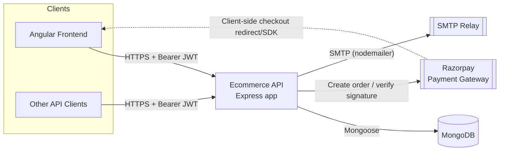
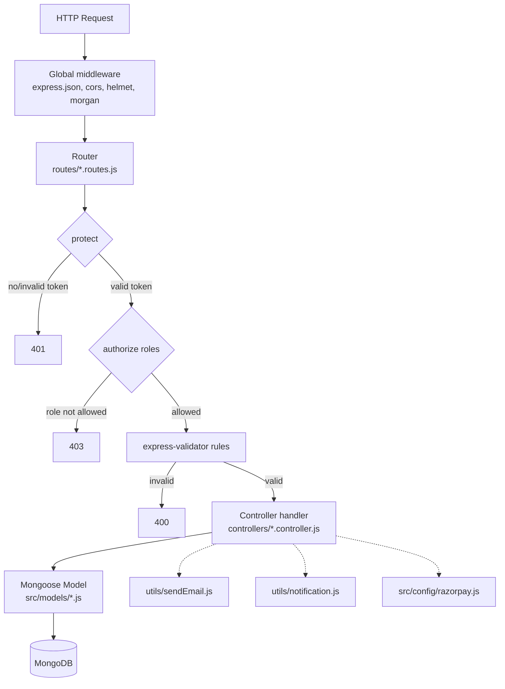
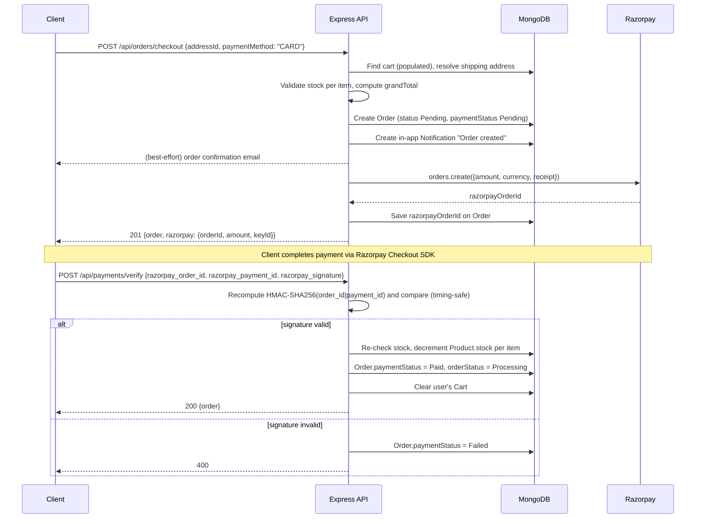
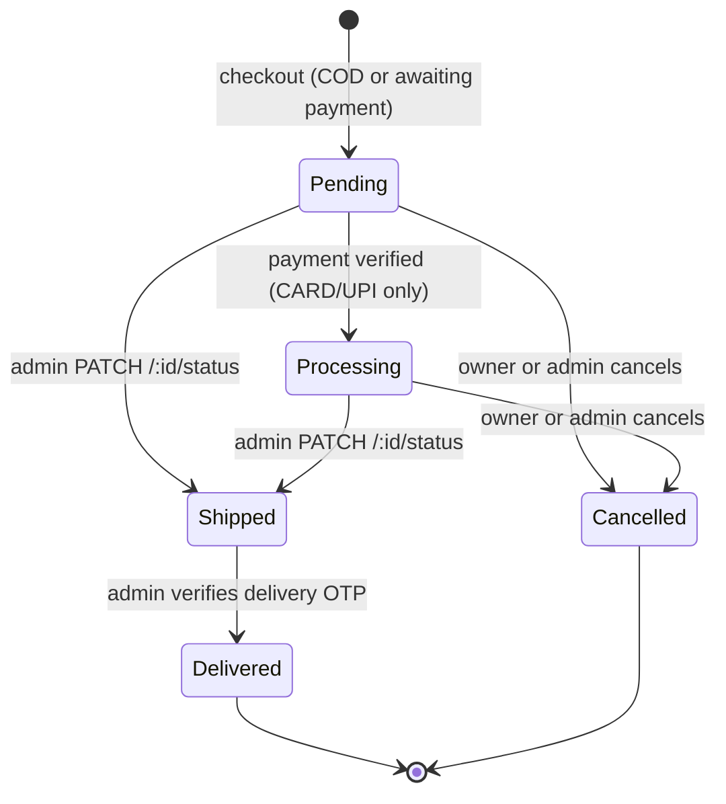

# Architecture Topology — Ecommerce API

## 1. System context



Notes on this diagram:
- The API never receives a payment webhook — the frontend completes the Razorpay checkout client-side and posts the resulting `razorpay_order_id` / `razorpay_payment_id` / `razorpay_signature` back to `POST /api/payments/verify`, which the API validates by recomputing the HMAC signature server-side.
- Email sending is synchronous and in-request (no queue/worker) — a slow SMTP relay directly adds to request latency for register/checkout/OTP/status-change endpoints.

## 2. Layered structure



Each controller function owns its own `try/catch` and shapes its own response — there is no shared error-handling middleware and no service/repository layer between controllers and Mongoose models. Controllers call models directly.

`protect` and `authorize` are plain Express middleware, composed per-route (or once via `router.use(protect)` for routes where every action needs a logged-in user — cart, wishlist, addresses).

## 3. Request flow example: checkout → payment (online methods)



For **COD**, the flow short-circuits: stock is decremented and the cart is cleared synchronously inside the `checkout` handler itself, with no Razorpay round trip and no separate `/payments/verify` call.

## 4. Order status lifecycle



Rules enforced in `order.controller.js`:
- `updateOrderStatus` only accepts `Pending | Processing | Shipped` as a target (admin-only) and refuses to change a `Delivered`/`Cancelled` order.
- `cancelOrder` is blocked once an order is `Shipped`, `Delivered`, or already `Cancelled`; cancelling restocks items only if `paymentMethod === "COD"` or `paymentStatus === "Paid"` (i.e., inventory that was actually reserved).
- `Delivered` is reachable only through the two-step OTP flow (`generateDeliveryOtp` → emails a 6-digit code, stored as a SHA-256 hash with a 10-minute expiry → `verifyDeliveryOtp` compares the hash). Both endpoints are admin-only.

## 5. Data model

```mermaid
erDiagram
    User ||--o{ Order : places
    User ||--o| Cart : owns
    User ||--o| Wishlist : owns
    User ||--o{ Address : has
    User ||--o{ Notification : receives
    User ||--o{ SignInActivity : "logs (by email, optional link)"
    Category ||--o{ Product : classifies
    Product ||--o{ CartItem : "referenced in"
    Product ||--o{ OrderItem : "snapshotted into"
    Product }o--o{ Wishlist : "saved in"
    Cart ||--|{ CartItem : contains
    Order ||--|{ OrderItem : contains

    User {
        string name
        string email UK
        string password "select:false"
        string role "customer|admin"
        string resetPasswordToken "select:false"
    }
    Product {
        string name UK
        number price
        number stock
        ObjectId category FK
        boolean isActive
    }
    Category {
        string name UK
        boolean isActive
    }
    Cart {
        ObjectId user FK-UK
    }
    Wishlist {
        ObjectId user FK-UK
        ObjectId[] products
    }
    Order {
        ObjectId user FK
        string paymentMethod "COD|CARD|UPI"
        string paymentStatus "Pending|Paid|Failed"
        string orderStatus
        string razorpayOrderId
        string deliveryOtp "select:false, hashed"
        number totalAmount
    }
    Address {
        ObjectId user FK
        string state "enum: Indian states"
        boolean isDefault
    }
    Notification {
        ObjectId user FK
        string type "system|order|payment|promotion"
        boolean isRead
    }
    SignInActivity {
        string email
        ObjectId user FK optional
        string status "Success|Failed"
    }
```

Key design points:
- **`OrderItem` is a denormalized snapshot** (`name`, `price`, `subtotal` copied at order time), not a live reference — historical orders are unaffected by later product edits/deletions.
- **`Cart` and `Wishlist` are one document per user** (`unique: true` on `user`), holding an array of sub-items/refs — not one collection row per cart line.
- **`Address.state`** is constrained to a fixed enum of Indian states/union territories (`src/constants/indianStates.js`); this API is India-market-specific (also reflected in `INR`-only Razorpay currency and rupee-formatted emails).
- **`SignInActivity`** documents self-expire after 90 days via a Mongo TTL index on `createdAt`.
- **`Product`** has a compound text index on `name`/`description`/`brand`, but `getProducts` currently filters via a `$regex` on `name` rather than `$text` search — the text index exists but isn't queried through it yet.

## 6. Deployment topology

The API is a single stateless Node.js process:

- **Horizontal scaling**: any number of instances can run behind a load balancer since there's no in-process session state — auth is a bearer JWT, verified independently by each instance.
- **State lives entirely in MongoDB** (single connection string, `MONGO_URI`). No cache layer, message queue, or job runner is present.
- **Outbound dependencies per request**: MongoDB (every request), Razorpay (checkout for CARD/UPI, and payment verification), SMTP (register/forgot-password/checkout/status-change/cancel/delivery-OTP/delivery-confirmation — all synchronous, in the request path, individually try/caught so a send failure degrades gracefully rather than failing the whole request, except forgot-password and delivery-OTP generation which roll back and fail the request if the email can't be sent).
- **No reverse proxy / TLS termination config in this repo** — `helmet()` sets security headers, but HTTPS termination, rate limiting, and any WAF/CDN layer are expected to be provided by the hosting environment.
- **File uploads**: `multer` is a declared dependency but no route currently uses it — product images are plain URL strings (`Product.images[].url`, `Product.mainImage`), implying image hosting (e.g. Cloudinary/S3) happens outside this API.

## 7. Known gaps

Worth knowing before extending this system — not necessarily "bugs" to opportunistically fix, but real behaviors:

- **Checkout is not transactional.** `checkout` performs Order creation, stock decrement, and cart clearing as separate sequential Mongoose writes. If the process crashes or a write fails partway (e.g. between order creation and stock decrement), the order and inventory can end up inconsistent. `SCALING.md` in the repo root describes a transaction-based design (`session.withTransaction`, shard keys, compound indexes, a sales-analytics aggregation endpoint) — **that describes an intended future state, not the current code**; none of it is present in `order.controller.js` or `src/models/Order.js` today.
- **Role changes don't take effect until re-login.** `protect` trusts the `role` claim embedded in the JWT at issuance time; `scripts/promoteToAdmin.js` updates the DB but a user's existing token keeps their old role until they log in again.
- **No centralized error handler / request-id tracing.** Every controller replicates its own `try/catch` → `{success:false,message:error.message}` pattern; there's no Express error-handling middleware, so raw error messages (including Mongoose validation internals) can reach clients.
- **`getProducts` search is a regex scan**, not using the `Product` model's own text index — fine at current scale, worth revisiting if the catalog grows large.
- **`seed.js` connects to a hardcoded local MongoDB URI** rather than `MONGO_URI`, so it's a dev-only convenience script, not environment-aware.
